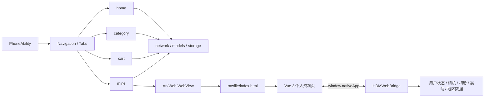

# 惠多美商城（HDM Mall）

一个以 HarmonyOS 原生端为主体、结合 Vue 3 H5 个人资料页的混合开发商城项目。

> **当前改造版**：新增 TypeScript + Node.js 自营后端，默认连接 `http://127.0.0.1:3000`。订单、库存、模拟支付、发货、收货和评价由后端持久化；支持确认绑定的亲友代付，以及代付订单中所有已绑定亲友代收。启动、接口和验收步骤见 [server/README.md](server/README.md)。下文涉及公开演示 API 和本地订单覆盖层的章节保留为旧版实践记录，不代表当前默认交易模式。

2026-10-28 当前验收入口：`pwsh -File scripts/verify-enterprise-baseline.ps1` 执行服务端类型检查、交易与生产配置测试、客户端逻辑回归；原生构建、Hypium 与设备验收分别执行，不由该命令代替；当前交易规则见 [交易规则与权限矩阵](docs/交易规则与权限矩阵.md)，生产化阶段进展见 [建设目标](docs/企业级项目建设目标.md)。

> **项目背景**
> 本项目以已有商城代码为基础，后续由本人持续完善和优化。个人实践重点包括 HarmonyOS 原生模块化整理、分类/搜索/详情商品展示一致性、SKU 交易边界、购物车与账号隔离的本地数据，以及 ArkWeb 与 Vue 3 H5 的资料和头像状态同步。

### 分工说明

- 初版：课程中跟随老师完成，作为首个提交 [61c3083](https://github.com/wangagan496/hdm-mall/commit/61c3083cb291bee5adba0aa41faed143c5f69515)（2026-08-09）一次性上传。初版已经包含 Navigation 路由表、相机与相册选图、axios 拦截器、语音搜索、服务卡片、瀑布流首页、Vue 3 H5 资料页、运行时权限申请，以及 5 个模块的工程结构。
- 后续工作：此后的提交（2026-08-12 至 2026-09-14）全部由本人独立完成。

### 我的工作

| 内容 | 主要技术 | 提交 |
| --- | --- | --- |
| 工程模块化重构：把 1 个公共模块拆成 7 个 commons HSP，加上 4 个 features HSP；猜你喜欢组件改为注入数据源，解除对 network 的依赖 | HSP、依赖注入 | [b87e320](https://github.com/wangagan496/hdm-mall/commit/b87e32042e4e5102866b7dab05766c1526158a2d)、[fec097c](https://github.com/wangagan496/hdm-mall/commit/fec097c42bd32a0d04706e99cd90a7ae4e4be541) |
| H5 桥接加固：改用 javaScriptProxy 暴露原生方法，permission 白名单只允许 rawfile 页面调用，页面销毁时注销；拦截详情接口失败时生成的兜底规格 | ArkWeb | [b87e320](https://github.com/wangagan496/hdm-mall/commit/b87e32042e4e5102866b7dab05766c1526158a2d) |
| 头像压缩与资料同步：缩放、居中裁方、JPEG 压缩后再上传；保存顺序改为"上传头像 → 保存资料 → 同步原生"，修复资料还没保存就先刷新原生页面的问题 | ImageKit、Preferences、AppStorage | [9e101b5](https://github.com/wangagan496/hdm-mall/commit/9e101b50938cc96aa3f4a4df2d37fae91ba973e5)、[d10a1d3](https://github.com/wangagan496/hdm-mall/commit/d10a1d38932090f18bbda890d908ac2a91ac891e) |
| H5 资料状态改由 Pinia 管理，已上传的头像地址会暂存，失败重试时不重复上传；新增 H5 的 CI | Pinia、GitHub Actions | [e64d058](https://github.com/wangagan496/hdm-mall/commit/e64d05818b0cf8c710d27deb839bba2d4afe74b8)、[ci.yml](.github/workflows/ci.yml) |
| 订单分页加载器：过滤已取消订单后不足一页时继续取数，按服务端页数判断是否结束，按订单编号去重，切换标签时作废旧请求 | 单元测试覆盖 | [cc3552e](https://github.com/wangagan496/hdm-mall/commit/cc3552e6402065367ef16a29ff0090abbf453338)、[1c4b679](https://github.com/wangagan496/hdm-mall/commit/1c4b6792d8d2acf3090a35e0d8f17d3def4ff2ed) |
| GET 请求按状态码重试，BusinessError 原样抛出并保留 httpStatus | @ohos/axios | [a6efa3f](https://github.com/wangagan496/hdm-mall/commit/a6efa3ff57f001cb41f5008cc0d423911239acc2)、[a81c7c5](https://github.com/wangagan496/hdm-mall/commit/a81c7c5dfe65eebd119e964428832e1712297e40) |
| 首页改为单个 WaterFlow + sections，推荐流恢复懒加载 | WaterFlow、LazyForEach | [2ba047b](https://github.com/wangagan496/hdm-mall/commit/2ba047bda196dc0f699a60c1e20ff887f2e07648) |
| 单元测试：初版只有模板占位用例，补充到 77 个有效用例 | Hypium、Hamock | [a6efa3f](https://github.com/wangagan496/hdm-mall/commit/a6efa3ff57f001cb41f5008cc0d423911239acc2)、[ad66d4c](https://github.com/wangagan496/hdm-mall/commit/ad66d4ce2214c3bbfe75b1c12bfd53c3c2e6ee55) 等 |

项目当前用于 HarmonyOS / ArkTS / ArkWeb 混合开发学习与作品展示，尚未上架应用市场。

## 项目能力

| 方向 | 当前实现 |
| --- | --- |
| 商城主流程 | 首页推荐、分类、搜索、商品详情与 SKU、购物车、结算页和个人中心 |
| 原生界面 | ArkTS + ArkUI，使用 `Navigation`、`NavPathStack`、`Tabs` 与状态装饰器组织页面 |
| 网络与状态 | Axios 请求封装、Token 注入、加载/空数据/异常状态处理、部分请求静默降级 |
| 本地数据 | Preferences 持久化用户信息、收藏与浏览足迹；收藏和足迹按登录账号隔离 |
| 混合开发 | ArkWeb 加载随应用交付的 Vue 3 H5，通过 `window.nativeApp` 完成原生与 H5 双向通信 |
| 设备能力 | H5 可调用原生相机、相册、震动和地区数据能力 |
| 支付演示 | 原生收银台调用自营后端模拟付款，由后端推进并持久化订单状态，不产生真实扣款 |
| 工程结构 | 原生端按 `commons`、`features`、`products` 拆分，H5 独立开发后构建进原生 `rawfile` |

## 技术栈

### HarmonyOS 原生端

- ArkTS、ArkUI、Stage 模型
- Navigation、NavPathStack、Tabs
- AppStorage、Preferences
- ArkWeb、JavaScript Proxy
- `@ohos/axios`
- Hvigor、OHPM

### H5 端

- Vue 3、TypeScript
- Vant、Pinia、Vue Router
- Axios、Vite
- `vite-plugin-singlefile`

## 架构概览



原生端负责商城主要页面、路由、网络、状态与本地数据；Vue 3 H5 负责个人资料编辑。H5 构建为单文件 `index.html`，随 HarmonyOS 应用一起交付，不依赖局域网开发服务器。

## 目录结构

```text
hdm-mall/
├─ mixed-development-h5/          # HarmonyOS 多模块工程
│  ├─ products/phone/             # 应用入口、PhoneAbility、根导航与 Tabs
│  ├─ commons/
│  │  ├─ constants/               # 全局常量与路由路径
│  │  ├─ models/                  # 业务模型
│  │  ├─ network/                 # Axios 请求封装
│  │  ├─ storage/                 # 用户、购物车、本地收藏与足迹
│  │  ├─ utils/                   # 通用工具
│  │  ├─ ui-components/           # 公共 ArkUI 组件
│  │  └─ device/                  # 相机、相册、震动、地区等设备能力
│  └─ features/
│     ├─ home/                    # 首页、搜索、商品详情与 SKU
│     ├─ category/                # 分类页面与分类数据适配
│     ├─ cart/                    # 购物车、结算、订单列表/详情、支付与支付结果页
│     └─ mine/                    # 登录、个人中心、本地数据页与 ArkWeb
└─ shoph5-vue3/                   # Vue 3 H5 个人资料页
   ├─ src/
   └─ scripts/sync-rawfile.mjs    # 兼容旧命令，重新执行移动端构建
```

## 个人实践重点

### 1. 原生工程模块化

将原先集中在公共模块中的能力按职责拆分为：

- `constants`：业务常量和页面路径；
- `models`：跨模块业务模型；
- `network`：请求实例、Token 注入和错误转换；
- `storage`：用户、购物车、收藏和浏览足迹；
- `device`：相机、相册、震动和地区数据；
- `ui-components`：跨业务复用的 ArkUI 组件；
- `home`、`category`、`cart`、`mine`：独立业务功能模块。

这样可以减少跨功能直接依赖，页面只组合所需的公共能力。

### 2. 商品展示一致性

围绕首页、分类、搜索结果和商品详情页，对商品数据进行了统一适配：

- 对齐同一商品的 ID、标题、主图与价格；
- 列表展示优先使用详情数据中的有效字段；
- 对图片地址和异常数据进行归一化；
- 单个详情请求失败时保留可展示的数据，避免整组商品不可用；
- 首页通过 `Promise.allSettled` 并发加载，部分接口失败时仍展示可用区块。

### 3. SKU 与交易边界

当详情接口不可用时，页面可以生成仅用于展示的兜底 SKU，但兜底 SKU 不属于后端真实对象 ID。因此在加入购物车和快捷购买前进行显式校验：

- 阻止 `_fallback_` SKU 进入交易请求；
- 加入购物车成功后才更新购物车状态；
- 快捷购买复用加入购物车结果，成功后才进入结算页；
- 请求失败时停留在当前页面并显示真实失败状态。

该处理用于保证“页面可展示”不会被误当成“数据可交易”。

### 4. 账号隔离的本地收藏与足迹

收藏和浏览足迹使用 Preferences 持久化，并根据当前登录账号生成独立存储作用域：

```text
favorite_goods_account_<account>
browse_history_account_<account>
```

未登录状态使用匿名作用域。旧版全局数据在登录后按规则迁移，避免不同账号之间互相看到本地记录。退出登录统一通过 `UserSession.logout()` 清理用户状态并刷新购物车。

> 收藏和浏览足迹当前是客户端本地能力，不描述为已经与后端账号数据同步。

### 5. ArkWeb 与 Vue 3 H5 通信

原生端通过 `javaScriptProxy` 注册 `window.nativeApp`，向 H5 提供：

| Bridge 方法 | 作用 |
| --- | --- |
| `getUser` | 读取 App 已保存的当前登录用户 |
| `updateUser` | 持久化资料并同步 AppStorage 状态 |
| `removeUser` | 统一退出登录 |
| `pickerCamera` | 调用原生相机 |
| `pickerPhoto` | 调用原生相册 |
| `vibrator` | 调用震动能力 |
| `getAreaColumns` | 获取地区选择数据 |

Vue 3 个人资料页通过类型声明约束 Bridge 接口。头像可以由相机或相册选择，在 H5 页面预览并上传，保存后再由 `updateUser` 同步回原生端。

### 6. 历史方案：本地支付收银台与订单覆盖层

以下仅说明旧版演示 API 配合本地覆盖层的方案，当前默认 `DEMO_ORDER_FLOW=false`，由自营后端处理交易：

- 确认支付后写入按登录账号隔离的本地覆盖层，订单进入待发货，不产生真实扣款；
- 演示环境没有真实支付回调与评价接口契约，支付、发货、签收、评价状态推进由本地覆盖层完成，列表、详情、支付结果页统一按「服务端状态 + 本地覆盖层 + 本地评价」合并展示；本地已提交评价时完成态显示「已评价」，详情页可回看星级和内容；
- 演示行为由 `GlobalVariable.DEMO_ORDER_FLOW` 显式开关控制：打开时演示 API 拒绝发货/收货操作也按本地覆盖层推进（`features/cart/.../DemoOrderFlow.ets`），关闭后只有服务端成功才推进状态，支付入口直接提示未接入支付渠道。

## 本地开发

### 1. 构建 H5 并同步到 HarmonyOS

H5 工程使用 `pnpm-lock.yaml` 锁定依赖。

```bash
cd shoph5-vue3
pnpm install --frozen-lockfile
pnpm run build:mobile
```

`build:mobile` 会依次执行桥接契约检查、类型检查和移动端生产构建，直接生成到以下目录，不再从 `dist` 复制：

```text
mixed-development-h5/features/mine/src/main/resources/rawfile/index.html
```

仅开发 H5 时可以运行：

```bash
pnpm run dev
```

### 2. 构建 HarmonyOS 应用

使用 DevEco Studio 打开 `mixed-development-h5`，安装 OHPM 依赖并配置本机调试签名后构建项目。

Windows 命令行示例：

```powershell
& "<DevEco Studio>\tools\hvigor\bin\hvigorw.bat" assembleApp --mode project -p buildMode=debug --no-daemon --no-incremental
```

这是多模块工程，命令行构建使用 project 模式；设备安装时使用项目产出的已签名 `.app` 包，而不是只安装单个 feature HAP。

> **签名安全：**证书、Profile、密钥库路径及密码只应保存在本机配置中，不应提交到公开仓库。公开提交前请再次检查 `build-profile.json5`。

### 3. 一键验证工程交付

仓库提供 `scripts/verify-project.ps1`，用于在本机复现 H5 检查、原生工程构建和签名 `.app` 产物检查。默认会执行完整的 H5 检查和原生 debug 非增量构建：

```powershell
.\scripts\verify-project.ps1
```

默认原生验证会先重新构建移动端网页；`-SyncH5` 也使用同一入口。独立网页构建仍输出 `dist`，旧 `sync:rawfile` 命令改为重新执行移动端构建，避免旧文件覆盖。调试迭代时可以用 `-Incremental`，或用 `-SkipH5` / `-SkipNative` 缩小验证范围；跳过 H5 不属于完整发布验证：

```powershell
.\scripts\verify-project.ps1 -SyncH5
.\scripts\verify-project.ps1 -SkipNative
```

脚本会检查 `DEVECO_SDK_HOME`、Hvigor 路径和 `build/outputs` 下最新的 `*-all-signed.app`。它不执行设备安装，也不把签名材料写入仓库。

服务地址由构建环境注入，开发默认仍可使用本机服务；release 要求实际 HTTPS 服务地址并禁止演示订单，发布验证不能跳过网页或原生构建，详见 [客户端环境配置与发布校验](docs/客户端环境配置与发布校验.md)。移动端网页不设置 `VITE_API_BASE_URL`，统一读取原生地址；独立网页正式构建则必须显式提供该变量。

CI 和 `verify-project.ps1 -SkipNative` 使用 `pnpm run build-only --mode mobile --outDir dist` 检查移动端 H5，依赖原生桥且不设置 `VITE_API_BASE_URL`；输出到 `dist`，不覆盖原生 rawfile，也不能作为独立网页部署。正式独立构建仍使用 `pnpm run build-only` 并提供实际公网 HTTPS API 地址，Vite 的校验保持启用；`-SyncH5` 和默认完整验证继续构建 mobile 模式并输出到原生 rawfile。

### 4. 接入 Jev 判断服务（订单咨询分流）

HDM Mall 的“帮助与客服”页已经接入一个低风险的判断入口：用户输入订单或售后描述后，客户端调用统一 `decision-service` 的 `hdm-mall/order-routing` 模板。返回结果只用于显示建议，不会修改订单、支付或退款状态。

先启动通用判断服务：

```powershell
cd <decision-service-project-root>
$env:TYPESAFE_MOCK = "true"
python -m uvicorn app.main:app --host 0.0.0.0 --port 8765
```

然后通过构建进程环境变量 `HDM_DECISION_SERVICE_URL` 设置地址，无需修改 `GlobalVariable.ets`：

- 模拟器访问宿主机：先尝试 `http://10.0.2.2:8765`；
- 真机调试：改成电脑和手机可互通的局域网地址，例如 `http://192.168.1.20:8765`；
- 正式环境：配置自己的 HTTPS 服务原点；未配置时关闭智能分流请求，不要把 TypeSafe API Key 放进客户端。

启动应用后进入“个人中心 → 帮助与客服”，输入“订单一直没有发货，应该怎么办？”并点击“智能分流”。Jev 服务不可用或置信度不足时，页面会提示联系人工，原有客服入口仍然可用。

验证服务端模板：

```powershell
$body = @{ project = "hdm-mall"; module = "order-routing"; state = "订单一直没有发货" } | ConvertTo-Json
Invoke-RestMethod -Method Post -Uri http://127.0.0.1:8765/api/decision/template `
  -ContentType "application/json" -Body $body
```

确认链路稳定后，再把 `TYPESAFE_MOCK` 改为 `false` 并配置服务端的 `TYPESAFE_API_KEY`，客户端代码不需要改动。

## 测试与验证

原生业务模块包含本地单元测试，覆盖部分关键数据与边界逻辑，例如：

- 分类和商品展示数据适配；
- 商品图片、价格与 SKU 归一化；
- 兜底 SKU 识别；
- 购物车展示逻辑；
- ArkWeb 用户数据合并；
- 本地收藏和浏览足迹。

构建成功只表示源码和打包流程通过。安装、页面导航、接口数据、设备能力与视觉效果需要在目标 HarmonyOS 设备或模拟器上分别验证。

原生工程的可复现构建检查统一使用 `scripts/verify-project.ps1`。当前工程根节点没有 `hvigorw test` 任务，Hypium 用例需要在 DevEco Studio 的测试配置或目标设备环境中单独执行；仓库不会把不存在的命令写成 CI 通过条件。

### 工程加固与稳定性验证

- 网络层只对幂等 GET 请求在网络错误、408、429 和 5xx 时做有限重试，创建订单、支付和其他写请求不会自动重放，避免重复业务操作。
- 同工程 HSP 依赖使用 `@module:<moduleName>` 管理，避免把同仓模块写成不可移植的本地 HAR 路径。
- 页面接口失败会进入明确的失败态或重试入口：首页、搜索、购物袋、订单、结算和支付页面不会把网络失败伪装成成功或无限加载。
- 支付结果页会查询服务端订单，并结合本地覆盖层展示演示支付结果；订单列表和详情共用 `OrderPresentation` 的状态文案与倒计时口径。本地已评价时完成态走 `getDisplayOrderStateText`，显示「已评价」而不是笼统的「已完成」。
- 取消订单只在旧接口不存在（HTTP 404/405）时降级到兼容路径，业务失败（如“已发货不能取消”）原样返回，不会对同一订单重复下发写请求。
- 订单状态支持本地覆盖层：演示环境没有真实支付回调或评价接口契约，支付、发货、签收、评价等推进写入按登录账号 scope 隔离的 Preferences 覆盖层；列表、详情、支付结果页统一按「服务端状态 + 本地覆盖层 + 本地评价」合并评估，并把无法与后端匹配的本地状态显式标记出来，不把本地演示状态伪装成真实订单状态。评价页的星级文案和快捷标签在 `EvaluationPresentation`，长度校验仍走 `DemoOrderStore.validateEvaluation`。
- 正式发布签名证书、Profile 与密钥库只保存在本机 DevEco Studio 配置中，不随仓库分发，安全注意事项见上文“签名安全”说明。

### 历史方案：本地演示订单的筛选与评价

- “待发货 / 待收货 / 待评价”首屏会补查本地覆盖层候选订单的最新详情，再与服务端分页合并、按订单 ID 去重和创建时间排序，服务端取消状态仍优先。
- 分页结束以服务端页数或空页为准，不会因一条订单被本地状态过滤就截断；失败保留重试入口，切换标签或账号后旧响应不写回。
- 评价页使用缩小布局的键盘避让模式，离开时恢复原来的模式；星级和正文仅保存在本机，供演示与回看。
- 演示模式下，评价保存到本机后统一回到最近的订单列表，跳过中间的订单详情页并保留列表标签；栈中没有订单列表时替换为列表入口。不等待远程评价接口，保存失败保留输入和错误提示，手动离开后不会再次自动回退。

## 当前边界

- 项目尚未正式上架应用市场；
- 当前商品、购物车和订单使用自营后端，初始化商品用于测试，尚无完整商品运营入口；
- 收藏、浏览足迹是本地 Preferences 数据，不代表后端已同步；
- 兜底 SKU 仅用于详情展示，不会提交到交易接口；
- 支付由自营后端模拟推进，不产生真实扣款，未接入正式商用支付；
- 项目演示视频可随求职材料提供。

## 仓库地址

<https://github.com/wangagan496/hdm-mall>
